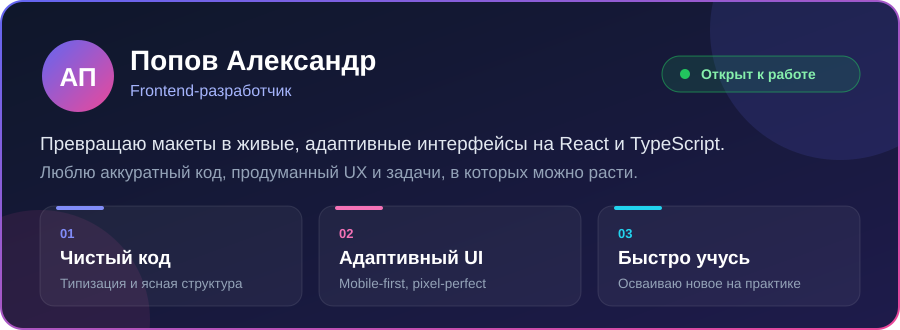
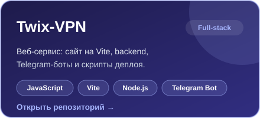
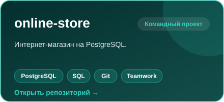

# Привет, я Александр 👋

  

&nbsp;&nbsp;&nbsp;&nbsp;&nbsp;&nbsp;&nbsp;&nbsp;

---

  

---

## 🛠 Технологии

### Основной стек
<table align="center"><tr>
<td align="center" width="90"> <b>HTML5</b></td>
<td align="center" width="90"> <b>CSS3</b></td>
<td align="center" width="90"> <b>SCSS</b></td>
<td align="center" width="90"> <b>Tailwind CSS</b></td>
<td align="center" width="90"> <b>JavaScript</b></td>
<td align="center" width="90"> <b>TypeScript</b></td>
<td align="center" width="90"> <b>React</b></td>
</tr></table>

### Инструменты
<table align="center"><tr>
<td align="center" width="90"> <b>Git</b></td>
<td align="center" width="90"> <b>GitHub</b></td>
<td align="center" width="90"> <b>Vite</b></td>
<td align="center" width="90"> <b>Figma</b></td>
<td align="center" width="90"> <b>npm</b></td>
</tr></table>

### Изучаю
<table align="center"><tr>
<td align="center" width="90"> <b>Next.js</b></td>
<td align="center" width="90"> <b>Redux</b></td>
<td align="center" width="90"> <b>Jest</b></td>
<td align="center" width="90"> <b>Node.js</b></td>
</tr></table>

---

## 🚀 Проекты

<table>
<tr>
<td>
  
</td>
<td>
  
</td>
</tr>
</table>

---

## 🤝 Что я привношу в команду

| 💡 Что делаю | 🧭 Как работаю |
|---|---|
| Адаптивная вёрстка по макету из Figma | Mobile-first и семантический HTML |
| SPA-интерфейсы на React + TypeScript | Типизация, понятные компоненты, чистый код |
| Стили на SCSS и Tailwind | Переиспользуемые стили, единая дизайн-система |
| Работа в Git / GitHub | Небольшие коммиты и понятные pull request'ы |

---

## 📫 Давай работать вместе

Открыт к предложениям и интересным проектам. Пиши, отвечу быстро.

 

&nbsp;&nbsp;&nbsp;&nbsp;&nbsp;&nbsp;&nbsp;&nbsp;

